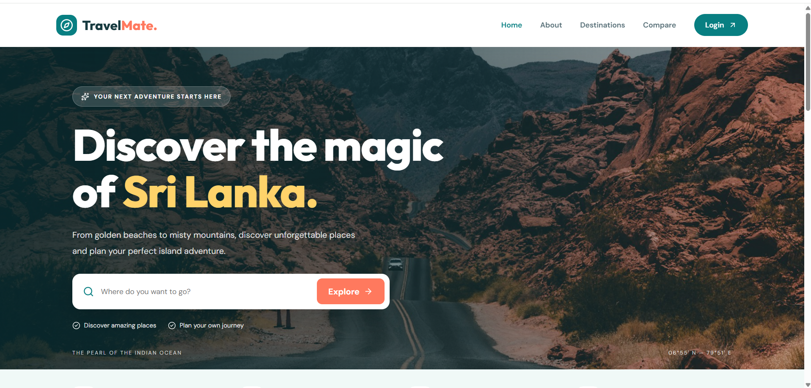

# 🌍 TravelMate – Travel Planning & Destination Discovery Platform

<p align="center">
  
</p>

<p align="center">
  <strong>Discover. Explore. Compare. Plan Your Journey.</strong>
</p>

<p align="center">
  A full-stack web application for discovering destinations across Sri Lanka and organizing personalized travel experiences.
</p>

---

## 📌 Overview

**TravelMate** is a full-stack travel planning and destination discovery platform developed to make exploring Sri Lanka easier and more convenient.

The platform allows users to discover tourist destinations, explore destination information, search and filter places based on their interests, compare destinations, and create personalized travel itineraries.

TravelMate brings essential travel discovery and planning features together in one user-friendly web application.

## ✨ Key Features

### 🗺️ Destination Discovery
- Explore tourist destinations across Sri Lanka.
- Browse destination information and descriptions.
- View detailed information about individual destinations.
- Discover destinations by category and district.

### 🔍 Search & Filtering
- Search destinations by name and location.
- Filter destinations by categories.
- Filter destinations by district.
- Easily find destinations based on travel interests.

### ⚖️ Destination Comparison
- Select and compare two destinations.
- View destination information side by side.
- Make more informed travel decisions.

### 📅 Personalized Itinerary Management
- Create personal travel itineraries.
- Add multiple destinations to an itinerary.
- View and manage saved itineraries.
- Edit and delete existing itineraries.
- Retain itinerary information in the database.

### 🔐 User Authentication
- User registration and login.
- Authentication and protected pages.
- Personalized user dashboard.
- Logout functionality.

### 📱 User Interface
- Responsive page layouts.
- Navigation between application sections.
- Interactive destination cards.
- User-friendly travel discovery experience.

## 🛠️ Technologies Used

| Technology | Purpose |
|---|---|
| React.js | Frontend development |
| JavaScript | Application functionality |
| CSS | Styling and responsive layouts |
| Node.js | Backend runtime |
| Express.js | REST API development |
| MySQL | Relational database management |
| REST APIs | Frontend and backend communication |
| Git & GitHub | Version control and project management |

## 🏗️ System Architecture

TravelMate follows a client-server architecture.

```text
        USER
          |
          v
   REACT.JS FRONTEND
          |
          | HTTP Requests
          v
   EXPRESS.JS REST APIs
          |
          v
     NODE.JS BACKEND
          |
          v
      MYSQL DATABASE
```

The React frontend communicates with the Express backend through REST APIs. The backend handles application logic, authentication, destination data, and itinerary operations, while MySQL stores the application's data.

## 📂 Project Structure

```text
TravelMate/
│
├── backend/
│   ├── config/
│   ├── controllers/
│   ├── routes/
│   ├── middleware/
│   ├── package.json
│   └── server.js
│
├── frontend/
│   ├── public/
│   ├── src/
│   │   ├── pages/
│   │   ├── services/
│   │   ├── App.jsx
│   │   ├── App.css
│   │   └── main.jsx
│   └── package.json
│
├── .gitignore
├── README.md
└── Travelmate.png
```

*Note: The structure above illustrates the main project organization. Some folders may differ depending on the actual implementation.*

## ⚙️ Installation & Setup

Follow these steps to run TravelMate locally.

### Prerequisites

Make sure the following are installed:

- Node.js and npm
- MySQL Server
- Git
- A code editor such as Visual Studio Code

### 1. Clone the Repository

```bash
git clone YOUR_REPOSITORY_URL
cd TravelMate
```

### 2. Backend Setup

Navigate to the backend directory:

```bash
cd backend
```

Install dependencies:

```bash
npm install
```

Create a `.env` file in the backend directory and configure your MySQL connection and application settings.

Example configuration:

```env
PORT=5000
DB_HOST=localhost
DB_USER=your_mysql_username
DB_PASSWORD=your_mysql_password
DB_NAME=travelmate
```

Use the actual environment variable names required by your backend configuration.

Create the required MySQL database and tables before starting the application.

Start the backend server:

```bash
npm run dev
```

### 3. Frontend Setup

Open a new terminal and navigate to the frontend directory:

```bash
cd frontend
```

Install dependencies:

```bash
npm install
```

Start the React development server:

```bash
npm run dev
```

Open the local URL displayed in your terminal to access TravelMate.

## 🗄️ Database

TravelMate uses **MySQL** as its relational database.

The database manages information such as:

- User accounts
- Tourist destinations
- Destination details
- Travel itineraries
- Itinerary and destination relationships

## 🎯 Project Objectives

- Simplify the process of discovering tourist destinations.
- Provide accessible information about Sri Lankan travel destinations.
- Help users compare destinations before planning trips.
- Make itinerary creation and management easier.
- Demonstrate full-stack web development using modern technologies.

## 🚀 Future Enhancements

- Interactive maps and navigation.
- Destination reviews and ratings.
- Weather information for destinations.
- More destination photographs and travel guides.
- Advanced itinerary recommendations.

## 👩‍💻 Author

**Kavithma Herath**

TravelMate – Travel Planning & Destination Discovery Platform

---

<p align="center">
  <strong>TravelMate – Discover Sri Lanka, One Destination at a Time.</strong>
</p>

